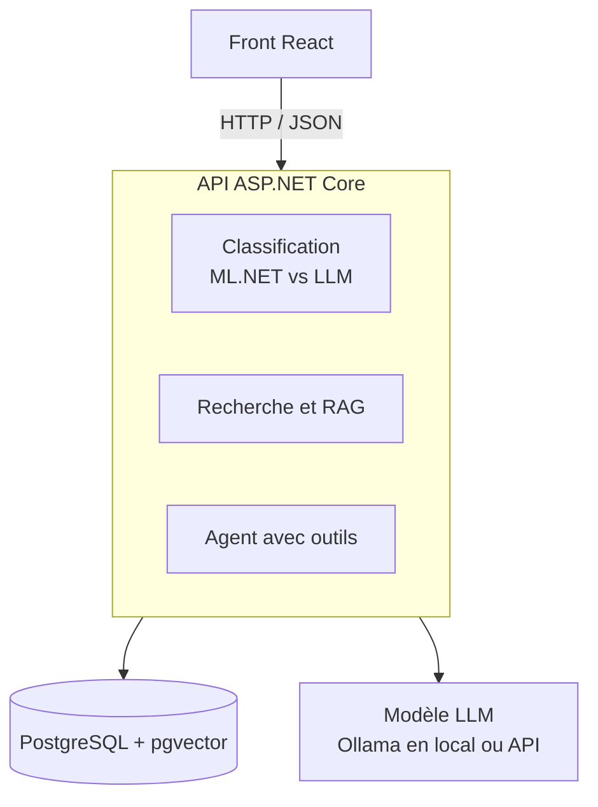

# Helpdesk IA

Assistant de support informatique qui trie les tickets, propose des réponses en citant la base de connaissances et agit sur les tickets en langage naturel. Projet personnel pour explorer, mesurer et expliquer plusieurs techniques d'IA dans une application .NET réaliste.

> **État : semaine 1 sur 5.** Le socle applicatif est en place (API, base de données, front, données fictives, CI). Les briques d'IA arrivent dans les semaines suivantes.

## Feuille de route

- [x] **Semaine 1 – Socle** : API ASP.NET Core, PostgreSQL + pgvector, front React, 500 tickets fictifs, CI
- [ ] **Semaine 2 – Classification** : catégorie et priorité prédites par ML.NET et par un LLM, comparées sur un jeu de test
- [ ] **Semaine 3 – Recherche et RAG** : tickets similaires par embeddings, réponses suggérées avec leurs sources
- [ ] **Semaine 4 – Agent** : assistant qui consulte et crée des tickets via des outils, avec confirmation avant toute action
- [ ] **Semaine 5 – Évaluation et démo** : résultats chiffrés, garde-fous contre l'injection de prompt, vidéo de démonstration

## Architecture



| Dossier | Contenu |
| --- | --- |
| `src/Helpdesk.Api` | API minimale ASP.NET Core (.NET 10), EF Core + Npgsql |
| `tests/Helpdesk.Api.Tests` | Tests xUnit : règles métier et intégrité des jeux de données |
| `web` | Front React + TypeScript (Vite) |
| `scripts/generate_tickets.py` | Générateur de tickets fictifs, reproductible |
| `data` | Historique chargé en base (`tickets.json`) et jeu de test réservé à l'évaluation (`tickets-test.json`) |

## Démarrer en local

Prérequis : Docker, SDK .NET 10, Node.js 22, Python 3.10 ou plus.

```bash
# 1. Base de données
docker compose up -d db

# 2. API (http://localhost:5080) : crée le schéma et charge l'historique au premier lancement
dotnet run --project src/Helpdesk.Api

# 3. Front (http://localhost:5173), dans un autre terminal
cd web
npm install
npm run dev
```

Tests : `dotnet test` à la racine, `npm run lint && npm run build` dans `web`.

Le contrat de l'API est publié en OpenAPI sur `http://localhost:5080/openapi/v1.json` en développement.

## Données

Les 500 tickets sont fictifs : aucune donnée réelle d'entreprise. Le script les génère à partir de modèles de demandes réalistes, avec une part de bruit volontaire sur la priorité pour que la classification ne soit pas triviale.

- **400 tickets d'historique**, chargés en base : ils serviront à l'apprentissage et à la recherche de tickets similaires.
- **100 tickets de test**, jamais chargés en base et répartis comme l'historique entre les six catégories : ils servent uniquement à mesurer la qualité.

Pour les régénérer : `python scripts/generate_tickets.py`. La graine et la date de référence sont fixes, donc le résultat est identique d'une exécution à l'autre ; la CI le vérifie.

## API

| Méthode | Route | Rôle |
| --- | --- | --- |
| `GET` | `/api/tickets?status=&category=&search=&page=&pageSize=` | Liste paginée et filtrée |
| `GET` | `/api/tickets/{id}` | Détail d'un ticket |
| `POST` | `/api/tickets` | Création (titre, description) |
| `PATCH` | `/api/tickets/{id}/status` | Changement de statut, résolution obligatoire pour clore |
| `GET` | `/health` | État de l'API |

Un ticket créé par un utilisateur n'a ni catégorie ni priorité : c'est le travail du modèle de classification de la semaine 2.

## Choix techniques

- **PostgreSQL + pgvector** plutôt qu'une base vectorielle dédiée : une seule base pour les données métier et les embeddings, moins de services à opérer.
- **Jeu de test séparé dès le départ** : les performances annoncées seront mesurées sur des tickets que les modèles n'ont jamais vus.
- **Énumérations stockées en texte** : requêtes SQL lisibles et pas de corruption silencieuse si l'ordre des valeurs change.
- **Règles métier isolées** (`TicketRules`) : testables sans base de données.
- **`EnsureCreated` pour la semaine 1**, remplacé par des migrations EF Core quand l'extension pgvector sera activée.
